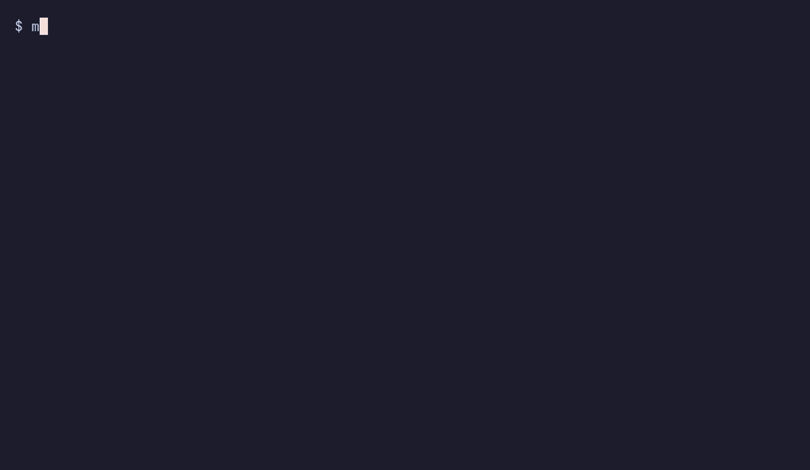
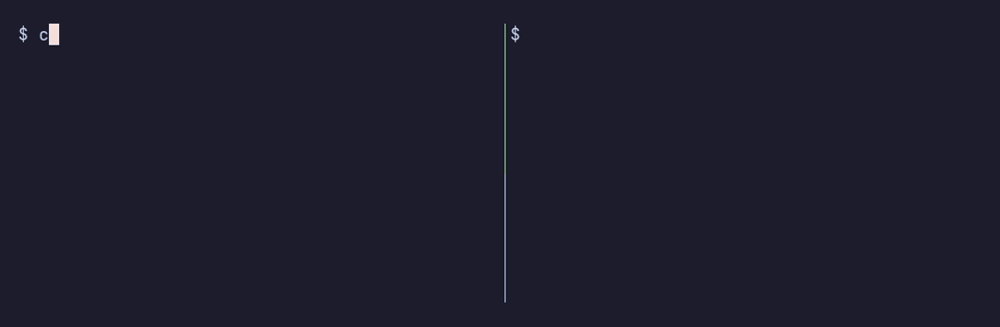

# Demos

Recorded against fictional accounts and a fake `claude`. See [Development](development.md#demos) to regenerate them.

## A profile per directory

`csw bind` writes a `.csw` file. With the shell hook, entering the directory loads that profile and leaving it goes back to the active one. A `.csw` naming a profile that does not exist prints one warning and falls back.

## Create, switch and delete

## Pick a profile without fzf

`csw use` without a name opens the built-in picker. Type a number, a name or part of a name.

## Two accounts at once

`csw run` pins a profile to one terminal, so each terminal can use a different account at the same time.

## Completions

The shell hook also registers completions for commands, flags and saved profile names.

## Rename a profile

`csw rename` moves the profile files and its stored login, and tells you what to update by hand.

